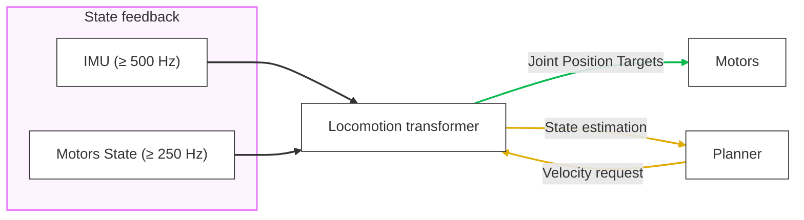

# Open Stompers

The goal of Open Stompers is to bring end-to-end learned autonomy to small legged robots.

## Prerequisites

- [UV](https://docs.astral.sh/uv/)
- [direnv](https://direnv.net/) (recommended)
- [FlatBuffers compiler (`flatc`)](https://flatbuffers.dev) (only required if you change any schemas)

## Set up

```sh
uv sync
uv run prek install # Install pre-commit hooks
uv run open_stompers_hardware_models fetch # Download hardware simulation assets
```

## Motion model


